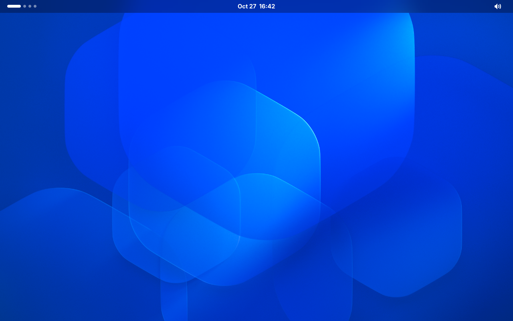
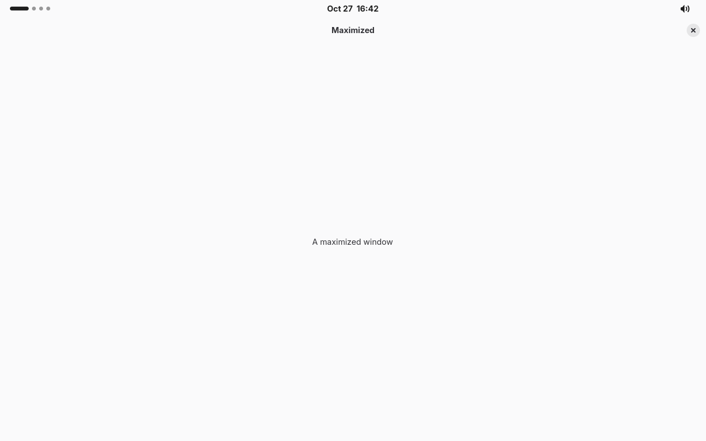

# GNOME Shell Plus

A GNOME Shell replacement built on Mutter. It looks like GNOME Shell, but
the top bar:

- is a **blurred, translucent** strip of the wallpaper when no window touches it, and
- turns **solid in the color of the maximized window's header** (light or dark text picked automatically) when one does.

The top bar is a GTK4 + libadwaita app, and the session follows the usual
GNOME GSettings (wallpaper, dark style, clock format, keybindings, night
light, …).

 

_(Taken from `make smoke`, which writes fresh ones to `dev/out/`.)_

## Architecture

```
┌──────────────────────── gnome-shell-plus (C, ~1.3k lines) ─────────────────────┐
│ libmutter MetaPlugin                                                            │
│  • wallpaper (MetaBackground ← org.gnome.desktop.background)                    │
│  • launches the panel as a privileged Wayland client, makes it a dock pinned to │
│    the top of the primary monitor (external constraint) and reserves its space  │
│    with struts                                                                  │
│  • finds the topmost maximized window and samples its header color              │
│  • dynamic workspaces (when org.gnome.mutter dynamic-workspaces is on)          │
│  • D-Bus: org.gnome.ShellPlus  (GetState / StateChanged / ActivateWorkspace …)  │
└──────────────────────────────────────┬──────────────────────────────────────────┘
                                       │ session D-Bus
┌──────────────── gnome-shell-plus-panel (Rust, GTK4 + libadwaita) ───────────────┐
│ workspace dots · clock + calendar menu · status icons + quick settings         │
│ blurred wallpaper backdrop ↔ solid color, with transitions                     │
└─────────────────────────────────────────────────────────────────────────────────┘
```

A GNOME Shell replacement has to live inside the compositor process, because
only the compositor can position the bar (Mutter has no layer-shell), read
other windows' pixels, or reserve screen space. Mutter has no Rust bindings,
so that part is a deliberately thin C shim. Everything you see is in the
Rust panel, which is where new features should go.

**Why the blur is done in the panel.** The bar only turns translucent when
nothing touches it, so the only thing behind it is the wallpaper. The panel
renders a blurred copy of that strip once per wallpaper change, using the
same placement rules as Mutter. That looks the same as a live backdrop blur
and costs nothing per frame.

| Path | What |
| --- | --- |
| `compositor/src/shellplus-plugin.c` | Panel management, struts, maximized-color sampling, dynamic workspaces |
| `compositor/src/shellplus-background.c` | Wallpaper |
| `compositor/src/shellplus-dbus.c` | The compositor ↔ panel interface |
| `compositor/src/shellplus-shell-dbus.c` | The `org.gnome.Shell` subset gnome-settings-daemon uses (OSD, media keys) |
| `compositor/src/shellplus-input-sources.c` | Keyboard layouts and Super+Space |
| `panel/src/panel.rs` | Bar window, translucent/solid switching |
| `panel/src/wallpaper.rs` | Blurred wallpaper strip |
| `panel/src/quick_settings/` | Status icons and the quick settings menu |
| `panel/src/notifications/` | Notification servers, banners, the date menu list |
| `panel/src/osd.rs` | Volume/brightness pop-up |
| `panel/src/keyboard.rs` | Keyboard layout indicator |
| `panel/src/media/` | Media player controls (MPRIS) in the date menu |
| `panel/src/clock.rs`, `workspaces.rs` | Clock/calendar, workspace indicator |
| `panel/src/style.css` | GNOME Shell-like styling |

### Settings it follows

| Schema | Keys |
| --- | --- |
| `org.gnome.desktop.background` | `picture-uri`, `picture-uri-dark`, `picture-options`, `primary-color`, `secondary-color`, `color-shading-type` |
| `org.gnome.desktop.interface` | `color-scheme`, `clock-format`, `clock-show-date`, `clock-show-seconds`, `clock-show-weekday`, `show-battery-percentage` |
| `org.gnome.desktop.notifications` | `show-banners` (Do Not Disturb), per-app settings |
| `org.gnome.desktop.input-sources` | `sources` (XKB layouts), `mru-sources`, `xkb-options`, `xkb-model` |
| `org.gnome.desktop.wm.keybindings` | `switch-input-source`, `switch-input-source-backward` (Super+Space) |
| `org.gnome.settings-daemon.plugins.color` | `night-light-enabled` |
| `org.gnome.mutter` | `dynamic-workspaces`, plus everything Mutter reads itself (`org.gnome.desktop.wm.*` keybindings and preferences, etc.) |

The quick settings menu talks to NetworkManager (Wi-Fi toggle and network
icon), UPower (battery), power-profiles-daemon (Power Saver), logind
(suspend, restart, power off) and PipeWire through `wpctl` (volume). Each
part hides itself if its service is missing.

## Building

Requirements: Mutter 50 development files (libmutter-18), GTK 4.16+,
libadwaita 1.6+, Rust, Meson. On Fedora 44:

```bash
sudo dnf install gcc meson ninja-build cargo mutter-devel gtk4-devel libadwaita-devel gsettings-desktop-schemas-devel
```

```bash
make
```

```bash
sudo make install PREFIX=/usr
```

For another Mutter version, pass its libmutter API number:
`meson setup build/compositor compositor -Dmutter_api=17`. Mutter's API
changes between releases, so expect small fixes.

## Testing on a Mac

Mutter is a Linux display server, so it can't run natively on macOS. There
are two complementary options.

### 1. Docker: compile checks and headless screenshots (already set up)

```bash
make check
```

```bash
make shots SCENARIO=quick_settings
```

`make check` compiles both parts against the real Fedora 44 stack.

`make shots` boots a complete headless session inside the container
(`dev/session.sh`) and runs a scenario script from `dev/scenarios/`, saving
screenshots and logs to `dev/out/<scenario>/`. The session has:

- a 1280×800 virtual monitor, captured through Mutter's ScreenCast API;
- a fake system bus with mocked NetworkManager (Wi-Fi networks, Ethernet),
  BlueZ (paired devices), UPower (battery), power-profiles-daemon and
  gsd-rfkill (`dev/mocks.py`, using python-dbusmock);
- PipeWire with fake speakers, headphones and a microphone;
- real pointer and keyboard input through Mutter's RemoteDesktop API
  (`Session.click`, `Session.key` in `dev/driver.py`);
- the panel's test-only D-Bus hook (`SHELLPLUS_PANEL_DEBUG=1`, see
  `panel/src/debug.rs`), which opens menus and presses buttons by widget name.

`make smoke` is the minimal scenario (translucent bar, then solid with a
maximized window). Everything runs natively on Apple Silicon (aarch64) and
is the fast inner loop for development.

### 2. A Linux VM: full interactive testing (recommended for real use)

Use [UTM](https://mac.getutm.app) (free) or Parallels/VMware Fusion with
**Fedora Workstation 44 for aarch64** (the "ARM64 / aarch64" ISO).

In UTM, pick *Virtualize → Linux* and enable *Hardware OpenGL acceleration*
(virtio-gpu-gl) for smooth compositing. Give it 4+ GB RAM and 4 cores.

Then, inside the VM, do one of these:

- **Nested in a window** (quickest edit/run loop, no logout). Mutter's
  devkit opens the compositor in a window inside your normal GNOME session:

  ```bash
  sudo dnf install mutter-devkit
  ```

  ```bash
  make && SHELLPLUS_PANEL=$PWD/build/panel/release/gnome-shell-plus-panel dbus-run-session -- build/compositor/gnome-shell-plus --wayland --devkit --wayland-display shellplus-dev
  ```

  `dbus-run-session` keeps it from taking over the real GNOME Shell's session
  bus. Launch apps into it from another terminal:

  ```bash
  WAYLAND_DISPLAY=shellplus-dev gnome-text-editor
  ```

- **As your real session**: `sudo make install PREFIX=/usr`, log out, click
  the gear on the GDM login screen, pick **GNOME Shell Plus**, and log in.
  The session script also starts the GNOME settings daemons (keyboard,
  power, night light, media keys…).

You can develop on the Mac and just run in the VM (e.g. share the folder via
UTM's VirtFS, or `git pull` inside the VM).

## Status / not yet implemented

Done:

- top bar: workspace indicator, clock + calendar menu, translucent/solid modes
- quick settings: volume and microphone (with device menus), brightness,
  Wi-Fi (network list), Wired, Bluetooth (devices), Power Mode, Night Light,
  Dark Style, Airplane Mode, battery, power menu with confirmation dialogs
- notifications: `org.freedesktop.Notifications` and `org.gtk.Notifications`
  servers, banners (actions, critical, Do Not Disturb, per-app settings),
  grouped list in the date menu, unread indicator
- volume/brightness pop-ups (OSD) and media keys: the compositor provides
  `org.gnome.Shell`'s `ShowOSD` and `GrabAccelerator(s)` for
  gnome-settings-daemon
- media player controls (MPRIS) in the date menu
- keyboard layouts: indicator and menu in the panel, Super+Space /
  Super+Shift+Space switching (most recently used first, like GNOME Shell)

Missing compared to GNOME Shell:

- overview, app grid, search, Super key, hot corner (`ToggleOverview` is stubbed in the D-Bus API)
- Alt-Tab switcher, window animations
- calendar events in the date menu
- lock screen, polkit agent, Wi-Fi password prompts, keyring prompts, on-screen keyboard
- IBus input methods (only XKB layouts are used), per-window layouts, the
  Super+Space switcher pop-up (a tap switches straight away), screenshot UI
- VPN and hotspot menus, multiple Wi-Fi/Bluetooth adapters
- XML wallpaper slideshows (the first image is used)
- panel only on the primary monitor (as in GNOME Shell)

Notes:

- With a stock Mutter install (no GNOME Shell), `org.gnome.mutter dynamic-workspaces`
  defaults to `false`, so you get a fixed 4 workspaces. GNOME Shell ships an
  override that turns it on; set it yourself if GNOME Shell isn't installed.
- The panel reads `.jxl` wallpapers (the GNOME default) through gdk-pixbuf,
  which needs `jxl-pixbuf-loader`. Without it the translucent bar falls back
  to a plain tint; the desktop itself still shows the wallpaper.
